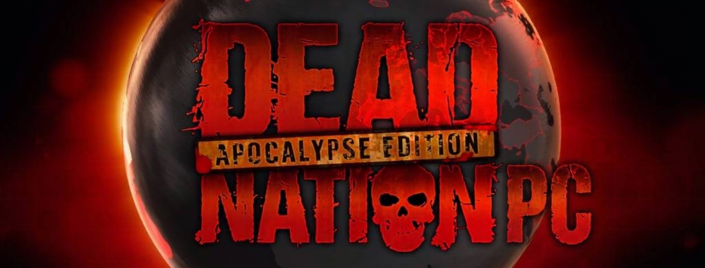

# Dead Nation (PS4) - Recompiled to PC

<a href="https://recomplauncher.com/game/dead-nation-ps4-recomp"><picture><source media="(prefers-color-scheme: dark)" srcset="https://recomplauncher.com/assets/press/launcher/badge-light.svg"></picture></a>

An (obviously) unofficial native PC runner for the PS4 version of <b>Dead Nation</b>, Housemarque's top-down zombie twin-stick shooter.

The game's own x86-64 code runs directly on Windows and Linux: the PS4 system libraries it calls are reimplemented, and its GPU commands are drawn with Vulkan.

🚨 **No game files are included** 🚨

This requires a decrypted dump of your own copy of the game. Tested with **CUSA00236** with **1.03 update**. Other versions may work but they are guaranteed to work.

## Features

- **30, 60, 90, 120, 144, 180, 240 or 360 FPS** at normal game speed (the PS4 version runs at 30): the engine's own frame clock follows the setting.
  - Note: there's no uncapped FPS, if your device can't reach the chosen rate the game slows down instead of skipping frames. Choose a rate your PC holds.
- **1440p and 4K rendering** (filtered down to the window), the PS4's native 1080p, or 720p for weaker GPUs. 4K costs about three times the GPU work of 1080p; pick the one that matches your screen.
- **Multiple aspect ratio options:** 21:9 and 32:9 show more of the level to the sides; the menus and HUD stay 16:9 in the middle. 4:3 and 16:10 show the same width and more of the level above and below, with the menus and HUD whole.
- **Windowed** (720p, 900p, 1080p, 1440p, 4K and more), **borderless** or **fullscreen**.
- **Built-in intro skip(-ish):** skipping entirely doesn't seem possible, so it (optionally) fast forwards to the main menu through the logos, the autosave notice, the brightness screen, the intro movie and the "Press OPTIONS" screen.
- **Display settings in the game:** press **F10**, or hold **Select** (View, Back, Share) for two
  seconds, for window mode, resolution, aspect ratio, VSync, frame rate and more, styled after the game's menus.
- **Settings outside the game:** `settings.exe` (beside the game and the setup; `settings` on Linux) shows the same page, plus speakers, intro skip and the title screen's Back, and saves each change at once. Keyboard, mouse or gamepad.
- **AMD FSR 1 RCAS sharpening**, on by default, switchable in the panel or with **F9**.
- **Keyboard and any gamepad.** DualShock 4 and DualSense work as they are, Xbox-style pads by
  button position.
- **Easy setup:** point the installer at your dumps, and it can add a desktop shortcut (on Linux, an application menu entry).
- **Self-contained:** shader caches, settings and paths stay in the game's folder; nothing goes to `%APPDATA%`.

## Requirements

- **Windows:** Windows 10 or 11, 64-bit. Python and everything else comes with the release.
- **Linux:** x86-64 with glibc 2.39 or newer (SteamOS 3.7, Ubuntu 24.04, Debian 13, Fedora 40 or
  newer, Arch) and Python 3.10 or newer (`python3`) for the setup.
- A CPU with AVX.
- A GPU with Vulkan 1.3 and a current driver (on Linux, Mesa or the NVIDIA driver).
- A decrypted dump of your own copy of the game, **CUSA00236** (version 1.00): the folder with `eboot.bin`,
  `sce_module`, `sce_sys`, `audio.pck`, `stream.dat`, `UI` and `Videos`.
- Its decrypted **1.03 update** (a folder with its own `eboot.bin` and `sce_sys`, e.g. `CUSA00236-patch`).
- Exactly these: the setup checks both `eboot.bin` files and refuses other versions or regions.

## Install and play

With [RecompLauncher](https://recomplauncher.com): install the recomp there, pick your dump folder and
the 1.03 update folder on its setup screen, and press Play. The display settings are on
the game's page too.

By hand:

1. [Download the latest release here](https://github.com/rcostanza/dead-nation-ps4-recomp/releases/latest)
2. Unzip the release anywhere, for example `C:\Games\DeadNation`.
3. Run `deadnation-setup.exe`.
4. Choose your **game folder** (the dump), the **update folder** (1.03), and a **save folder** (by default `save` inside the release folder). Each row says whether the folder is usable. Press **Install**: setup prepares the game from your dumps in a few seconds and offers a desktop shortcut. Your dumps are only read, never changed.
5. Press **Play Game**. Later, start `deadnation.exe` or the shortcut.

Starting `deadnation.exe` before the setup (or after a folder it was set up with is moved or deleted) opens the setup.

Run `deadnation-setup.exe` again any time to change folders; it offers to copy your saves when the save folder moves. Untick **Skip the intro movies** there (or set `skip_intro=0` in `settings.ini`) to see them again.

Setup also works from the command line:

```
deadnation-setup.exe --game <dump> --update <folder> [--save <folder>]
```

### On Linux

1. Extract the release anywhere you can write: `tar -xzf deadnation-pc-<version>-linux-x64.tar.gz -C ~/Games`
2. Run `deadnation-setup`: from a file manager it asks with dialogs, in a terminal it asks there. It also
   takes `--game <dump> --update <folder> [--save <folder>]`.
3. Start the game from the menu entry it adds, or run `./deadnation`.

On a Steam Deck, do this in Desktop Mode; _Add a Non-Steam Game_ in Steam then lists the menu entry.

### Updating

Unzip the new release over the old folder and start the game: on its first start it prepares itself again from the same folders (a few seconds, with a progress window). No need to run the setup again. Your folders, saves, settings and shader caches are kept.

## Settings

`settings.ini` in your save folder holds every setting, each with a comment. The **Display Settings** panel (**F10**, or hold **Select** for two seconds) changes most of them while the game runs and saves them when it closes:

- window mode, windowed resolution (applied a second after you stop changing it) and monitor. The fullscreen modes pick their size from the screen;
- VSync, and tearing with VSync off (the least input delay);
- aspect ratio: 4:3, 16:10, 16:9, 21:9 or 32:9 (at the next start);
- frame rate: 30 (the PS4's), 60, 90, 120, 144, 180, 240 or 360, held to what your display refreshes at (180 on a 120 Hz display runs at 120) unless VSync is off with tearing allowed;
- render resolution (720p, 1080p, 1440p or 4K, at the next start; 4K is the heaviest by far, so match it to your screen);
- sharpening (AMD FSR 1 RCAS, on by default), applied at once; **F9** also switches it over the game, to compare;

`title_back_exits=0` stops Back on the title screen from asking to close the game.

**settings.exe** (`settings` on Linux), in the game's folder next to the setup, changes the same options without starting the game, on the same page as the panel, plus the speakers (`audio_channels`), the intro skip and Back on the title screen. Each change is written at once into the `settings.ini` the game reads at its next start (the save folder's, or the one beside the game until the game has made that one); `settings.exe --config <file>` edits another. Arrows and Enter, a gamepad's d-pad and Cross, or the mouse (click a setting to step it, right-click to step back); Esc closes it. Changes made while the game runs apply at its next start.

## Controls

The game sees one DualShock 4. Any gamepad works, mapped by button position: on an Xbox pad A B X Y
are Cross, Circle, Square, Triangle, LB/RB are L1/R1, LT/RT are L2/R2, Menu is Options and View
clicks the touchpad. The keyboard works alongside a gamepad (no mouse aiming _yet_):

| Keys                      | PS4                      |
| ------------------------- | ------------------------ |
| W A S D / I J K L         | left stick / right stick |
| arrow keys                | d-pad                    |
| Space, Enter              | Cross                    |
| Escape, Backspace, `;`    | Circle                   |
| F / H                     | Square / Triangle        |
| Q, Page Up / O, Page Down | L1 / R1                  |
| E / U                     | L2 / R2                  |
| X / M                     | L3 / R3                  |
| Tab, P                    | Options                  |
| T                         | touchpad click           |

| Shortcut                                                  | What it does                                    |
| --------------------------------------------------------- | ----------------------------------------------- |
| **F10**, or hold **Select** 2 s                           | Display Settings                                |
| **F9**                                                    | sharpening on or off                            |
| **F4**, **Select+Start**, or **Back** on the title screen | asks "Exit Dead Nation?" (No is selected first) |
| **Alt+F4**                                                | closes the game without confirmation            |

## When something goes wrong

The game logs to `deadnation.log` in the `log` folder of your save folder. If it closes by itself, it
says so and keeps that log as `crash-<date>-<time>.log` in the same folder; attach that file when
you report the problem. If the picture freezes, leave the game running for half a minute before
closing it: after 20 seconds without a new frame it writes what every thread is doing to the log.

## Building from source

[docs/building.md](docs/building.md) covers the toolchain, building, tests and packaging, and
[docs/development.md](docs/development.md) how the runner works and how to work on it.

## 🤖 AI usage disclaimer 🤖

**_This project was thoroughly made by AI._**

I (human) am a programmer, but I know nothing about C++ which is required to make this possible. And so, I've done precisely three things in this project:

1. Paid for AI
2. Told AI what to do
3. Tested out whatever AI did

## Credits and license

Based on [resogun-recomp](https://github.com/rcostanza/resogun-recomp), itself inspired by [theatrhythm-fbl-pc](https://github.com/YAPhoa/theatrhythm-fbl-pc).

GPL-2.0-or-later, see [LICENSE](LICENSE). Runtime follows [shadPS4](https://github.com/shadps4-emu/shadPS4). Dead Nation is a game by Housemarque, published by Sony Interactive Entertainment; this project is not affiliated with or endorsed by either.
